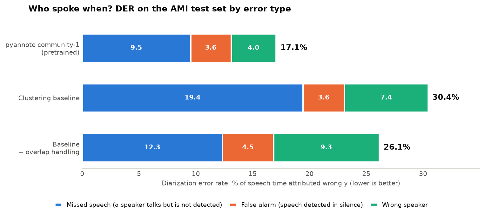
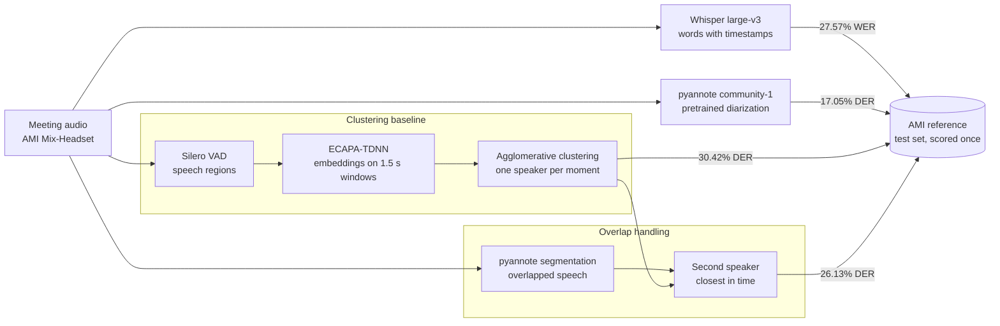

# TourDeParole

Speaker-attributed meeting transcription ("who said what") evaluated on the AMI Meeting Corpus.

Three diarization systems are compared on the AMI test set (16 meetings, 9.06 h, Mix-Headset audio): the pretrained pyannote pipeline, a clustering baseline built from separate parts (Silero VAD, ECAPA-TDNN speaker embeddings, agglomerative clustering), and the same baseline with overlap handling. Every parameter is tuned on dev, and test is scored once.

<picture>
  <source media="(prefers-color-scheme: dark)" srcset="figures/der_test_dark.png">
  
</picture>

Each bar adds up to the diarization error rate (DER), scored without collar and with overlapped speech included. Overlap handling trades missed speech for some wrong-speaker errors, because the added speaker is not always the right one. Whisper large-v3 transcribes the meetings with 27.57% WER.

In progress: speaker-attributed transcripts scored with cpWER, and meeting notes written by a local LLM.

## Key findings

- Most of the baseline's missed speech is overlapped speech. It gives one speaker to each moment, so 4520 of its 5969 s of missed speech fall where two people talk at once.
- Adding a second speaker in detected overlaps brings DER from 30.42% to 26.13%, about a third of the gap with pyannote. With perfect overlap detection it would reach 22.22%.
- Short turns are the hardest. In turns under 1 s, 70% of the time overlaps another speaker, often a quick "yeah" over the current one. The baseline gives 18.5% of that time to the right speaker, 32.1% with overlap handling, and pyannote 40.7%.
- Telling the baseline how many speakers there are barely changes its DER, so the remaining confusion comes mostly from the embeddings.
- WER follows overlap too. Across meetings the correlation is r = 0.97, although the most overlapped meetings are also the only unscripted ones in the test set.

## How it works



Whisper large-v3 (through faster-whisper) transcribes each meeting with word timestamps. The pretrained pyannote [community-1](https://hf.co/pyannote/speaker-diarization-community-1) pipeline is the reference point for diarization. Its 17.05% DER matches the model card, which is a good check that the data and scoring are set up right.

In the clustering baseline, Silero VAD finds speech, an ECAPA-TDNN model from [speechbrain](https://hf.co/speechbrain/spkrec-ecapa-voxceleb) embeds 1.5 s windows, and average-linkage clustering on cosine distance groups the windows of each meeting into speakers. The embeddings are centered on the meeting mean first. Without that, most windows end up in one large cluster.

Overlap handling follows Bullock et al. (ICASSP 2020). The pyannote segmentation model marks overlapped frames, and every turn inside an overlap gets a second speaker, the closest other speaker in time.

DER is computed with pyannote.metrics and WER with jiwer after the Whisper text normalizer, both accumulated over the split. The methods, tuning choices and full error analysis are in [docs/details.md](docs/details.md).

## Results

Diarization on the AMI test set, no collar, overlapped speech scored. Oracle speech detection takes the speech regions from the reference, which leaves only the clustering errors.

| System | Speech detection | DER | Missed | False alarm | Confusion |
|--------|------------------|-----|--------|-------------|-----------|
| pyannote community-1 | pyannote | 17.05% | 9.52% | 3.58% | 3.95% |
| Clustering baseline | Silero | 30.42% | 19.43% | 3.64% | 7.36% |
| Clustering baseline | oracle | 23.50% | 14.55% | 0.00% | 8.95% |
| + overlap handling | Silero | 26.13% | 12.34% | 4.48% | 9.32% |
| + overlap handling | oracle | 19.62% | 7.45% | 0.83% | 11.34% |

Share of reference turn time given to the right speaker, by turn length (baseline with Silero):

| Turn length | Turns | Overlapped | pyannote | Baseline | + overlap handling |
|-------------|-------|------------|----------|----------|--------------------|
| < 1 s  | 3247 | 69.6% | 40.7% | 18.5% | 32.1% |
| 1-2 s  | 1080 | 56.8% | 59.5% | 46.5% | 56.9% |
| 2-5 s  | 1376 | 42.6% | 76.6% | 63.5% | 71.5% |
| > 5 s  | 1790 | 19.4% | 93.1% | 80.2% | 84.0% |

The other scoring settings, the known-speakers runs and per-meeting numbers are in [docs/details.md](docs/details.md#results) and `results/`. On an RTX 4060 Laptop GPU, Whisper takes 100 min for the test set, pyannote 19 min and the clustering baseline under 2 min.

## Setup

Requires Python 3.12 and an NVIDIA GPU with CUDA. pyannote needs a Hugging Face token with the model conditions accepted (`hf auth login`).

```
py -3.12 -m venv .venv
.venv\Scripts\activate
pip install torch torchaudio --index-url https://download.pytorch.org/whl/cu128
pip install -e .
```

The evaluation follows the standard [AMI diarization setup](https://github.com/pyannote/AMI-diarization-setup) (pinned commit `67c2d53`): Full-corpus-ASR split, `only_words` reference RTTMs and Mix-Headset audio. Test and dev take about 2.2 GB.

## Reproduction

From a shell with the virtual environment active (Git Bash on Windows), this runs the whole pipeline in order:

```
bash scripts/reproduce.sh
```

Each module of `src/tourdeparole/` is also a command of its own, `python -m tourdeparole.<module> --help`, listed here in pipeline order:

| Module | Role |
|--------|------|
| `download_ami` | AMI diarization setup, manual annotations and audio |
| `references` | Speaker-attributed reference transcripts |
| `transcribe` | Whisper large-v3 transcription with word timestamps |
| `diarize_pyannote` | Pretrained pyannote diarization |
| `vad` | Speech detection with Silero VAD, or oracle speech from the reference |
| `embed` | ECAPA-TDNN embeddings on sliding windows |
| `cluster` | Agglomerative clustering of the embeddings into speakers |
| `overlap` | Overlapped speech detection and second speaker assignment |
| `der`, `wer` | Scoring |
| `analysis` | Overlapped speech, speaker counts and errors by turn length |
| `plot` | README figures: DER by error type, and a speaker timeline of a meeting excerpt |

Model outputs go to `outputs/` and scores to `results/`. The clustering stages run with both Silero and oracle speech, `--tune` sweeps parameters on dev, and test is scored once.

## License

The code is released under the MIT license by Théo Phan ([Aer-3888](https://github.com/Aer-3888) on GitHub). The AMI Meeting Corpus is distributed under CC BY 4.0 and is not part of this repository.
